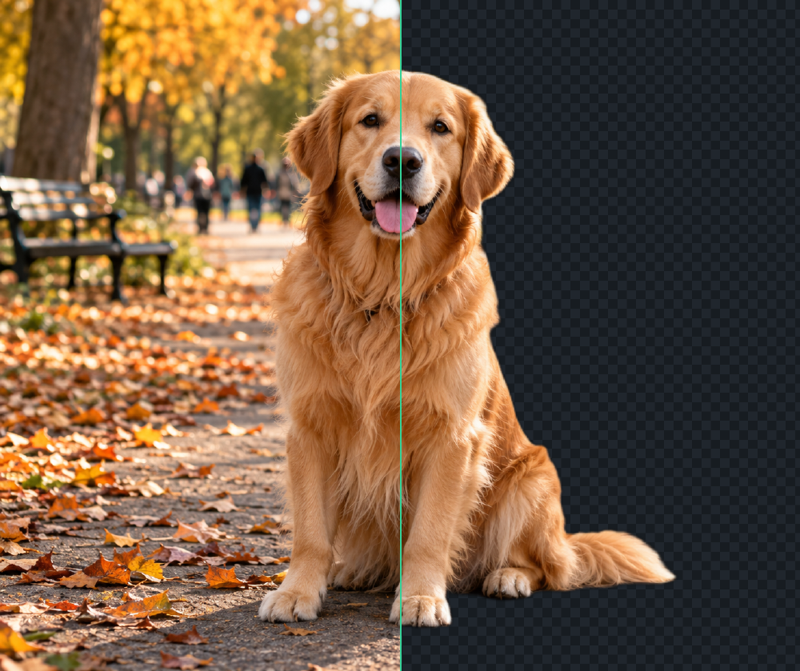

# RMBG — background removal on your device

[](https://github.com/Velmet44/rmbg/actions/workflows/ci.yml)

**Free · Open-source (MIT) · No account · No credits · No artificial app resolution cap · No image upload.**

RMBG runs segmentation locally in your browser — WebGPU when available, CPU/WASM
otherwise. Drop a photo, inspect the cutout, correct the mask if needed, and
export. Image pixels are never sent to an RMBG server. On first use, your browser
downloads the pinned Transformers.js runtime from jsDelivr and model weights
(~98 MB) from Hugging Face; both are cached for later visits. The site also uses
GoatCounter for aggregate page and app metrics (no image data; details below).

**Try it now: https://velmet44.github.io/rmbg**

| Before → after, one frame |
|---|
|  |

*An example output from the app. The two halves are the same frame, so nothing about the cutout is hidden by a different crop or zoom. This is illustrative, not a photographic quality benchmark.*

## Use it

1. Open the link above (desktop or mobile).
2. Drop an image — first use downloads and initializes the runtime and model; later visits usually reuse the browser cache.
3. Inspect (before/after, split view, mask), refine if needed, export PNG/WebP/JPEG (plus AVIF where your browser can encode it).

## What works today

- Single-image flow: upload → remove → inspect → correct → export
- A Remove background switch: turn it off to see and export the original photo — the cutout is kept, so turning it back on is instant
- Inspect: before/after, split with a movable divider, mask, and an overlay view that veils what was removed so you can spot what the AI wrongly kept
- Erase/restore brushes (Apply commits, Clear discards), guided click-to-region, drag-a-box AI recompute
- Backgrounds: transparent, solid color, custom image — with subject scale/rotation/position
- Finishing: drop shadow, edge feather + defringe
- One undo timeline across AI, brushes, and settings
- Sequential batch queue with per-item retry, open-in-editor, and ZIP export
- Export at original resolution or a custom size — PNG, WebP, JPEG, plus AVIF where your browser can encode it; JPEG transparency guard (never silently flattened)

## Limitations and roadmap

Photographic cutout quality has not yet been validated against an annotated
torture set, and there are no accepted device benchmark reports yet. CPU/WASM can
be slow on weaker devices; guided selection is deterministic color-region
growing, not promptable AI. The full app has not yet been exercised with the
network disabled after caching, and the project's privacy audit remains open.
Still open: a photographic quality set, real-device measurements, manifest
validation, and self-hosting the runtime and weights to enable multithreaded
WASM. See [SPEC.md](SPEC.md) for the plan and [benchmarks/GATE.md](benchmarks/GATE.md)
for what has and has not been measured.

## How it works

- Segmentation: BiRefNet-lite 512px ONNX (MIT), via Transformers.js — WebGPU fp16, WASM fallback
- **The WASM fallback is single-threaded**, because serving the COOP/COEP headers that multithreading needs would block the cross-origin model download. The only CPU figure on record is 6–11 s per 512px pass in Node ([GATE.md](benchmarks/GATE.md)); no browser WASM pass has ever been timed, so treat CPU inference on a weak machine as slow rather than fast.
- Masks use float alpha rather than binary values, so soft edges can be preserved when the model predicts them; original pixels are never mutated
- One swappable `SegmentationAdapter`; the engine is pure TypeScript with a DOM-free unit suite
- Inference runs in a Web Worker, so the page stays interactive during a long CPU pass
- No image-processing backend: photos stay on-device. The site uses GoatCounter for aggregate page views and fixed app events (model readiness, inference/recompute and export outcomes, and optional feedback votes), plus page/referrer, browser, approximate-location, and screen-size metadata. No image pixels, filenames, or dimensions are sent. See the [analytics FAQ](https://velmet44.github.io/rmbg/#faq) and the [public aggregate dashboard](https://velmet.goatcounter.com/) (updated hourly).

## Benchmark snapshot

<!-- bench:start -->
<!-- generated by `npm run bench:summary` (2026-10-21) — do not edit by hand -->

_No accepted reports yet._ Run the benchmark on your machine and submit the JSON — see
[benchmarks/README.md](benchmarks/README.md#contributing-a-report).
<!-- bench:end -->

Model provenance (revisions, licenses, checksums): [models/manifest.json](models/manifest.json).
That manifest is kept by hand — nothing in CI validates it, and its SHA-256 was
computed once, out of band (see [SPEC §5.6](SPEC.md#56-what-is-enforced-and-what-is-only-written-down)).

## Contribute

Bugs, questions, and feature ideas are welcome — an issue is not required before
opening a PR. Use the app's **Report an issue** action or the
[GitHub issue forms](https://github.com/Velmet44/rmbg/issues); please do not
attach private photos. For code changes and benchmark submissions, start with
[CONTRIBUTING.md](CONTRIBUTING.md). For security reports, see
[SECURITY.md](SECURITY.md) instead of opening a public issue.

## Develop

Requires Node.js 20+.

```sh
npm ci
npm run typecheck --workspace @rmbg/engine
npm run test --workspace @rmbg/engine       # DOM-free engine suite
npm run typecheck --workspace @rmbg/app
npm run dev --workspace @rmbg/app            # dev server
npm run build --workspace @rmbg/app && npm run preview --workspace @rmbg/app
                                           # production build on localhost:8901
```

`npm test` at the root runs every workspace that has a `test` script; CI
(`.github/workflows/ci.yml`) runs the same commands one step at a time. The
in-browser Quick benchmark is a low-friction first contribution: run
`npm run bench`, open `/bench.html`, and follow the report steps in
[benchmarks/README.md](benchmarks/README.md). Quick mode needs no model download.

## License

MIT — see [LICENSE](LICENSE). Third-party model weights retain their own
licenses, recorded in [models/manifest.json](models/manifest.json) and
[models/LICENSE-AUDIT.md](models/LICENSE-AUDIT.md).
